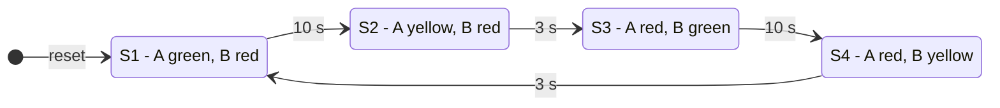

# Digital Traffic Light Controller (Verilog FSM)

Open Hardware Nexus (OHN) paired GitHub assignment: a two-road traffic light controller built as a Finite State Machine (FSM) with a counter-based timer, written in Verilog HDL and verified by simulation.

## 1. Project overview and objectives

This project designs and simulates a digital controller that runs the traffic lights of an intersection of two roads, Road A and Road B. The objectives are to:

- investigate an engineering problem and learn the needed concepts independently (FSMs, clocks, counters),
- design and implement a digital system in Verilog,
- verify it with a testbench and waveforms,
- collaborate through GitHub (Issues, branches, commits, Pull Requests, reviews).

## 2. Problem statement and system requirements

The controller regulates two intersecting roads. Each road has a Red, Yellow and Green light. The design must:

1. control the signals of Road A and Road B,
2. give each road independent Red, Yellow and Green outputs,
3. never show Green on both roads at the same time,
4. show Yellow first whenever a road goes from Green to Red,
5. keep Road B Red while Road A is Green, and the other way round,
6. run continuously through a fixed sequence,
7. be implemented as an FSM,
8. time each state with a clock and a counter.

Required sequence:

| State | Road A | Road B | Duration |
|---|---|---|---|
| 1 | Green | Red | 10 seconds |
| 2 | Yellow | Red | 3 seconds |
| 3 | Red | Green | 10 seconds |
| 4 | Red | Yellow | 3 seconds |

After state 4 the controller returns to state 1 and repeats.

## 3. FSM concepts applied

- **Finite State Machine (FSM):** a circuit that is in exactly one of a fixed number of states at a time and moves to another state according to rules, on a clock tick. Our controller has 4 states.
- **States and transitions:** a state is one light combination (for example "Road A green, Road B red"). A transition is the move to the next state, which happens when the counter reaches the time limit of the current state.
- **Moore vs Mealy:** in a Moore machine the outputs depend only on the current state. In a Mealy machine they depend on the state and the current inputs. This design is a **Moore** machine, because the lights depend only on the state.
- **Clock:** a signal that switches between 0 and 1 at a fixed frequency. Registers update only on its rising edge, which keeps the whole circuit in step and gives us a time reference to count.
- **Counter as a timer:** a register that adds 1 on every clock tick. Time elapsed = ticks x clock period, so the number of ticks needed for a duration is `clock frequency x seconds`.

## 4. Design methodology

1. Listed the inputs and outputs of the system.
2. Identified the 4 states and the time each one lasts.
3. Drew the state diagram and the state transition table.
4. Decided the timing mechanism (a counter with a per-state limit).
5. Wrote the Verilog design in three parts: state and counter register, limit selection, and output logic.
6. Wrote a testbench with its own clock, simulated in EDA Playground and captured the waveforms.

**Inputs and outputs**

| Signal | Direction | Meaning |
|---|---|---|
| `clk` | input | system clock |
| `reset` | input | active high, returns the controller to state 1 |
| `a_green`, `a_yellow`, `a_red` | output | Road A lights (1 = on) |
| `b_green`, `b_yellow`, `b_red` | output | Road B lights (1 = on) |

## 5. State diagram and state transition table

Each arrow is labelled with how long the current state lasts before the controller moves on. The reset input always returns the controller to S1.



**State transition table** (outputs are those shown while in the current state, as in a Moore machine)

| Current state | Condition to leave | Next state | Road A | Road B |
|---|---|---|---|---|
| S1 | counter reaches 10 s | S2 | Green | Red |
| S2 | counter reaches 3 s | S3 | Yellow | Red |
| S3 | counter reaches 10 s | S4 | Red | Green |
| S4 | counter reaches 3 s | S1 | Red | Yellow |
| any | `reset` = 1 | S1 | - | - |

## 6. Clock and timing mechanism

The timer is a counter built into the design, not a ready-made hardware timer.

- A parameter `CLK_FREQ` holds the number of clock ticks per second. Its default is `50000000` (50 MHz, a common FPGA board clock).
- The limits are `LONG = 10 * CLK_FREQ` (the 10-second states) and `SHORT = 3 * CLK_FREQ` (the 3-second states).
- A 32-bit register `count` adds 1 on every rising clock edge. When `count == limit - 1`, the count restarts from 0 and the FSM moves to the next state. (The count starts at 0, so it counts exactly `limit` ticks.)
- At 50 MHz, 10 seconds is 500,000,000 ticks. This needs 29 bits, so a 32-bit counter is enough.

## 7. Verilog implementation overview

File: `Design.sv`, module `traffic_light`.

- **State register and counter** (`always @(posedge clk)`): on reset the state becomes S1 and the count becomes 0. Otherwise, when the limit is reached, the count restarts and the state moves on (the 2-bit state wraps from S4 back to S1). Otherwise the count goes up by 1. The reset is synchronous.
- **Limit selection** (`always @(*)`): the limit is `LONG` in S1 and S3, and `SHORT` in S2 and S4.
- **Output logic** (`always @(*)`): a `case` on the state turns on the right lights, after switching all six off first.

## 8. Simulation procedure and results

**Procedure**

1. The design and the testbench were run in EDA Playground.
2. The testbench (`Testbench.sv`) is described in the "Testbench and Simulation" section at the end of this README, written by Ettu Finrinmi Paul.
3. Simulating the real 50 MHz value would take over a billion clock ticks per cycle, so the testbench uses a small value for CLK_FREQ: 10. This means 10 clock cycles stand for one second, so the 10-second states last 100 clock cycles and the 3-second states last 30. The design logic is exactly the same, only the number the counter counts to changes. The design file keeps the real default of 50,000,000.
4. The waveforms were viewed in EPWave. In the waveform the state is shown as a number: S1 = 0, S2 = 1, S3 = 2 and S4 = 3.

<!-- To add the waveform picture: upload the screenshot to the repo, then remove these comment marks and put the real file name in the brackets.

-->

**Results**

- The lights follow the required order: A green/B red, then A yellow/B red, then A red/B green, then A red/B yellow.
- The durations are in the ratio 10 : 3 : 10 : 3, as required. The `limit` signal switches between the long and short values with the state.
- Both roads are never green at the same time, since no state turns on both green lights.
- Each road goes through Yellow before Red.
- After the last state the controller returns to S1 and repeats. The testbench checks this explicitly and prints PASS: Sequence repeated - Back to S1 when it succeeds.
  
## 9. Challenges and how they were addressed

| Challenge | How it was addressed |
|---|---|
| Moving from a microcontroller timer (ready-made) to building the timer ourselves | Built a counter register that counts clock ticks, with `limit = clock frequency x seconds` |
| Simulating a 50 MHz clock takes far too long | Made the clock frequency a parameter and set a small value in the testbench |
| Counter size for 500,000,000 ticks | Calculated that 29 bits are needed and used a 32-bit counter |
| Understanding FSM structure | Split the design into state register, next-state logic and output logic |

## 10. Repository structure and contributions

```
README.md
Design.sv      Verilog design
Testbench.sv   testbench
```

| Person | Contribution |
|---|---|
| Ettu Finrinmi Paul (GitHub: Finrinmip) | Testbench, simulation and waveforms, repository setup |
| Temiterin Akinde | Verilog design, state diagram, README and documentation |

Work was divided between the two team members as shown above.

## 11. References and learning resources

- HDLBits: https://hdlbits.01xz.net/wiki/Main_Page
- EDA Playground: https://www.edaplayground.com/
- Nandland: https://nandland.com/
- Claude AI

# Traffic-light-controller-OHN-Testbench and Simulation
OHN Assignment

The testbench (`traffic_light_tb.v`) is used to verify the functionality of the digital traffic light controller.
It generates the required clock and reset signals and monitors the outputs of the controller during simulation.
The testbench verifies the following: Initialization of the traffic light controller, execution of the four traffic light states in their various orders, timing of Green and Yellow signals, Proper transition between the traffic light states, Continuous repetition of the traffic light sequence and Prevention of simultaneous Green signals on both roads.
A reduced clock frequency parameter is used during simulation to minimize simulation time while preserving the required timing relationship between the traffic light states.
The simulation results are examined using waveform visualization and PASS/FAIL messages.


